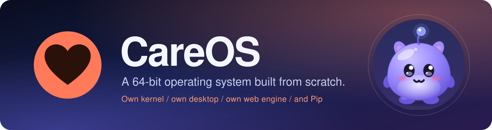
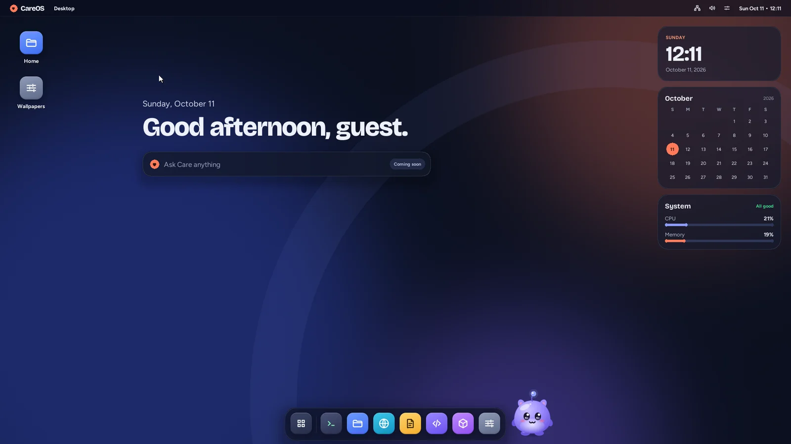
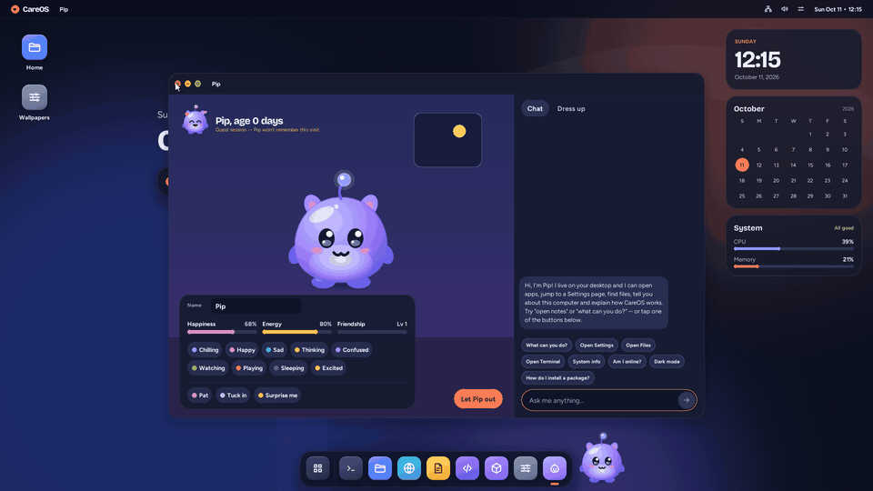
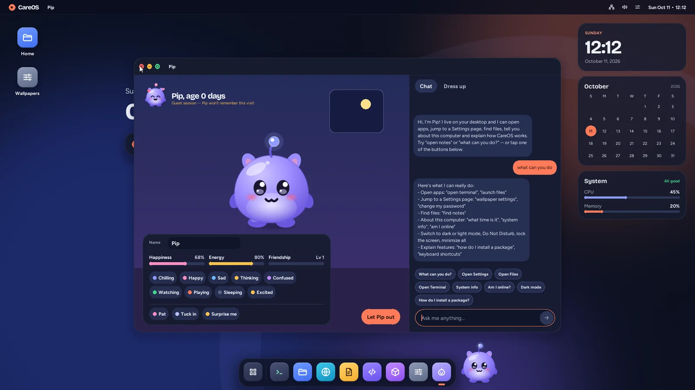
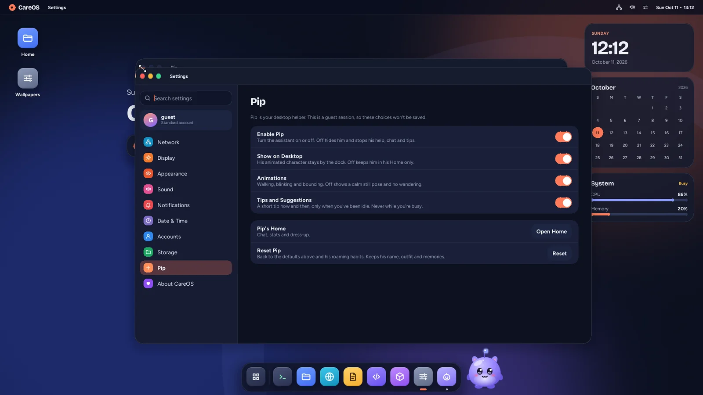
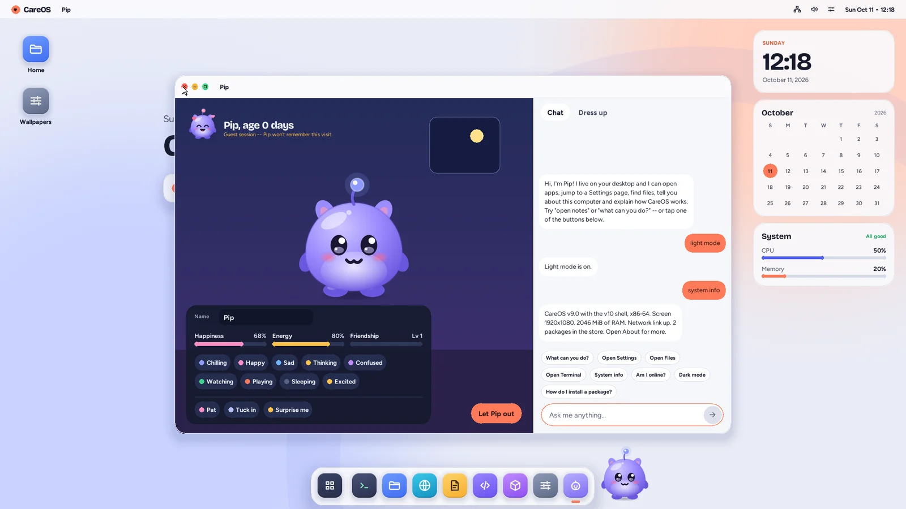
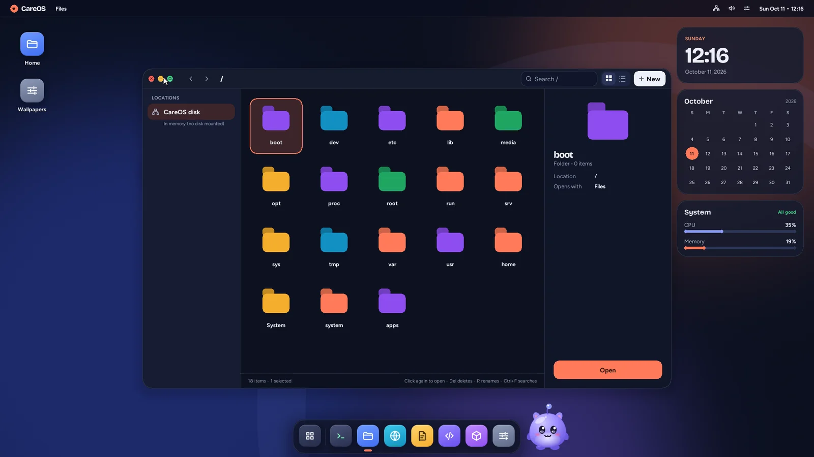
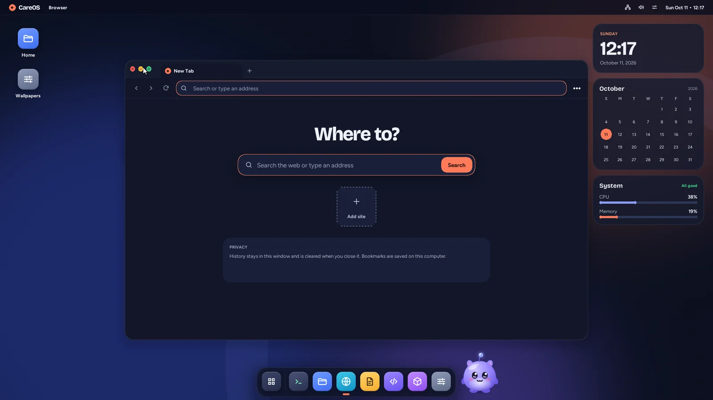
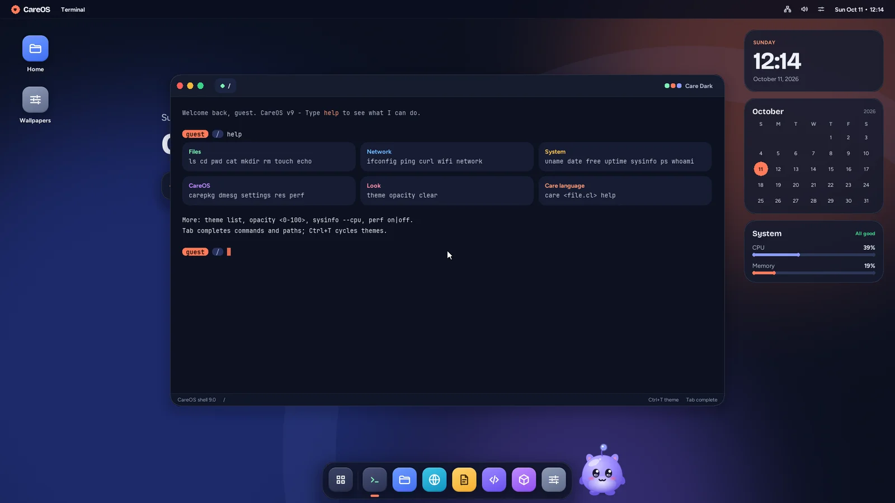

<p align="center">
  
</p>

<p align="center">
  
  
  
  <a href="LICENSE"></a>
</p>

<p align="center">
  A 64-bit operating system written from scratch in C and assembly: its own kernel, window manager,
  desktop shell, apps, web browser engine, and a friendly desktop assistant called <b>Pip</b>.<br>
  It boots with GRUB, draws everything itself on a linear framebuffer, and runs in QEMU or VirtualBox.
</p>

<p align="center">
  
</p>

---

## Meet Pip

<table>
  <tr>
    <td width="50%" valign="top">
      
    </td>
    <td width="50%" valign="top">
      
    </td>
  </tr>
</table>

Pip lives by the dock: he idles, wanders, naps and reacts to what you do. Click him to open his Home and chat.

- Does real things: opens apps, jumps to a Settings page, finds files, switches dark/light mode, locks the screen, and reports the time, memory, network and open windows
- Explains how CareOS works: packages, Terminal commands, the Care language, shortcuts, workspaces
- Asks before anything risky, never deletes files, and says so when something is not supported yet
- Turn him on or off, hide him, reduce animations or silence his tips in **Settings > Pip**; choices are saved per user

<table>
  <tr>
    <td width="50%"> Pip" width="100%"></td>
    <td width="50%"></td>
  </tr>
  <tr>
    <td align="center"><sub>Settings > Pip</sub></td>
    <td align="center"><sub>The light theme</sub></td>
  </tr>
</table>

---

## The desktop and apps

<table>
  <tr>
    <td width="50%"></td>
    <td width="50%"></td>
  </tr>
  <tr>
    <td align="center"><sub>Files</sub></td>
    <td align="center"><sub>Browser, on the native Weave engine</sub></td>
  </tr>
  <tr>
    <td colspan="2"></td>
  </tr>
  <tr>
    <td colspan="2" align="center"><sub>Terminal</sub></td>
  </tr>
</table>

**Desktop**
- Glass-style shell with a menu bar, dock, launcher (tap `Super`), Control Center, notifications and widgets
- Dark, light and auto themes, accent colours, wallpapers, real blurred glass
- Window manager with snapping, four workspaces (`Ctrl+1`..`Ctrl+4`), animations and a lock screen
- Accounts with sign-in, guest sessions and per-user settings

**Apps**

| App | What it does |
|---|---|
| Terminal | Shell with `ls`, `cd`, `cat`, `ping`, `carepkg`, `care`, history and Tab completion |
| Files | Browse folders on the ext2 disk |
| Notes | Markdown notes saved in your home folder |
| Editor | Write and run scripts in the **Care** language |
| Browser | Native engine with HTML, CSS, layout, forms and JavaScript (QuickJS) |
| Packages | Install, update and remove `.care` packages |
| Settings | Network, display, appearance, sound, notifications, date and time, accounts, storage, Pip |
| System Monitor, Network Monitor, Calculator, Clock, Paint, Users | The everyday tools |
| Maze, 3D demo, DOOM | Games and demos (DOOM needs your own `DOOM1.WAD`) |

**Under the hood**
- x86_64 long mode, paging, a scheduler, syscalls and ring 3 user programs
- ATA disk driver, ext2 filesystem, VFS
- e1000 network driver with an IP stack and TLS
- Software-rendered UI: custom vector icons, runtime fonts, an integer rasterizer for Pip
- Host-side unit tests for the pure logic (`make host-test`)

---

## Build and run

You need `gcc`, `nasm`, `make`, `grub-mkrescue` (with `xorriso`) and `qemu-system-x86_64`. On Windows, use WSL.

```bash
./setup.sh        # installs dependencies on Debian/Ubuntu, builds, and launches QEMU
# or, by hand:
make              # builds careos.iso and the disk image
make run          # boots it in QEMU
make host-test    # runs the unit tests on your host compiler
```

Other targets: `make run-1080p`, `make run-kvm`, `make run-whpx`, `make run-nowindow`.

DOOM is optional. Put a `DOOM1.WAD` in the repository root before building if you want it; it is not included.

To try it in VirtualBox, create a 64-bit "Other" VM, attach `careos.iso`, and use an Intel PRO/1000 network adapter.

---

## Repository layout

| Path | Contents |
|---|---|
| `boot/`, `kernel/`, `drivers/`, `net/` | Boot code, kernel, hardware drivers, network stack |
| `gui/` | Window manager, compositor, UI kit, fonts, icons, and `gui/pip/` (Pip) |
| `apps/` | The built-in applications |
| `web/` | The browser engine and its vendored third-party libraries |
| `shell/`, `include/` | Text shell fallback, headers, minimal libc |
| `tests/` | Host unit tests and ring 3 test programs |
| `tools/` | Asset and font generators, QEMU helpers |
| `iso/` | GRUB configuration for the boot image |

---

## Contributing

See [CONTRIBUTING.md](CONTRIBUTING.md). Licensed under the terms in [LICENSE](LICENSE).
